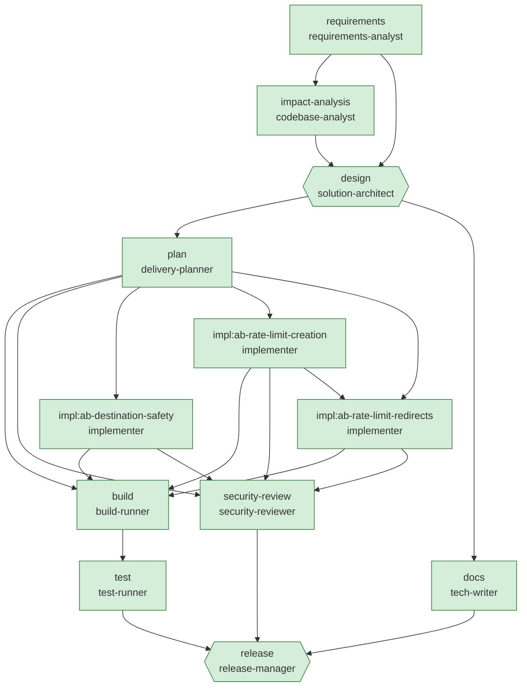

# Engineering summary — Ambiguous: "make it safer and handle more traffic" with a mid-run requirement change

| Run | Scenario | Status | End-to-end | Graph version | Audit chain |
|---|---|---|---|---|---|
| `ambiguous-20261003-201014` | ambiguous | **Succeeded** | 10.2s | v4 | verified (167 events) |

> All nodes completed and all gates passed.

**What this scenario demonstrates:** The analyst refuses to guess: vague terms become clarification questions with proposed defaults; the product owner answers one explicitly (30 creates/minute) and accepts the rest as recorded assumptions. Scale and analytics work are explicitly deferred. A host-configuration change (Program.cs) is routed to a tech lead by change-control policy. After the first build the product owner changes the requirement (rate-limit redirects too): only affected nodes go stale, the planner's previous expansion is retracted and its changes compensated, a new plan (graph v+1) is executed, and the earlier clarification is formally superseded.

## 1. Requirement understanding

**Raw request** (every version, including upstream changes):

- v1 by `human:requester`: "People are abusing the shortener. Make it safer, make sure it can handle more traffic, and the analytics should be better."
- v2 by `human:product-owner`: "People are abusing the shortener. Make it safer, make sure it can handle more traffic, and the analytics should be better. UPDATE from the product owner: scrapers are hammering popular short links, so rate limiting must apply to redirects as well."

**Normalised problem:** Change the existing URL shortener to: rate limit redirects; rate limit link creation; block internal destinations, without breaking existing clients.

| Ambiguous term | Found | Resolution |
|---|---|---|
| safer / abuse | "safer" | Q-ABUSE=rate limiting and destination checks; Q-RATE=30 per minute; Q-REDIRECT-LIMIT=no (superseded by explicit requirement) |
| more traffic | "more traffic" | Q-SCALE=no target yet; defer infrastructure changes to a follow-up with load testing |
| better / improved | "better" | Q-ANALYTICS=defer: no concrete metric defined; keep current analytics |

| Id | Requirement | Capability | Priority |
|---|---|---|---|
| FR-1 | Limit redirect requests per client with a generous budget. | rate-limit-redirects | P1 |
| FR-2 | Limit link creation per client; excess requests receive 429 with Retry-After. | rate-limit-creation | P1 |
| FR-3 | Reject destination URLs pointing at loopback, private, link-local or internal hosts. | destination-safety | P1 |
| NFR-1 | Limits are configuration-driven (RateLimiting section). | rate-limit-creation | P1 |
| NFR-2 | Partitioned per client address. | rate-limit-creation | P1 |
| NFR-3 | No DNS resolution on the create path (latency, DNS-rebinding TOCTOU). | destination-safety | P1 |
| NFR-4 | Every change ships with automated tests that verify its acceptance criteria. | * | P0 |
| NFR-5 | No secrets or personal data in code or logs (policy-enforced). | * | P0 |

**Assumptions**

- In-memory storage is acceptable for this iteration; the repository port allows a durable store later.
- Authentication/authorisation is out of scope for this iteration (gateway responsibility).
- Q-ABUSE: proposed default accepted — rate limiting and destination checks.
- Q-SCALE: proposed default accepted — no target yet; defer infrastructure changes to a follow-up with load testing.
- Q-ANALYTICS: proposed default accepted — defer: no concrete metric defined; keep current analytics.

**Out of scope / follow-ups**

- Scalability/infrastructure work: no quantified target yet — follow-up with load testing.
- Analytics improvements: no concrete metric defined — follow-up with product.

## 2. Codebase impact (brownfield)

Blast radius **5** production files, risk **Medium**. Existing endpoints: `POST /api/links`, `GET /api/links/{code}`, `GET /api/links/{code}/stats`, `DELETE /api/links/{code}`, `GET /{code}`.

| File | Why | Symbols |
|---|---|---|
| `src/UrlShortener.Api/Api/LinkEndpoints.cs` | touches rate-limit-redirects, rate-limit-creation | MapPost, RedirectToTarget |
| `src/UrlShortener.Api/Domain/LinkValidator.cs` | touches destination-safety | LinkValidator, ValidateTargetUrl |
| `src/UrlShortener.Api/Program.cs` | touches rate-limit-creation | AddUrlShortener, Program |
| `src/UrlShortener.Api/ServiceCollectionExtensions.cs` | touches rate-limit-creation | AddUrlShortener |
| `src/UrlShortener.Api/Services/LinkService.cs` | touches destination-safety | LinkValidator, ValidateTargetUrl |
| `tests/UrlShortener.Tests/DestinationSafetyTests.cs` | touches destination-safety | LinkValidator, ValidateTargetUrl |
| `tests/UrlShortener.Tests/DomainTests.cs` | touches destination-safety | LinkValidator, ValidateTargetUrl |
| `tests/UrlShortener.Tests/RateLimitingTests.cs` | touches rate-limit-creation | Program |
| `tests/UrlShortener.Tests/TestDoubles.cs` | touches rate-limit-creation | Program |

Data flows:

## 3. Design

Incremental change to the existing layered service; impacted: LinkEndpoints.cs, LinkValidator.cs, Program.cs, ServiceCollectionExtensions.cs, LinkService.cs, DestinationSafetyTests.cs, DomainTests.cs, RateLimitingTests.cs, TestDoubles.cs.

| Method | Path | Responses | Change |
|---|---|---|---|
| POST | `/api/links` | 201, 400, 409, 429 | adds 429 |
| GET | `/{code}` | 301, 404, 302, 429 | adds 429 |
| GET | `/api/links/{code}/stats` | 200, 404 |  |
| GET | `/api/links/{code}` | 200, 404 |  |
| DELETE | `/api/links/{code}` | 204, 404 |  |
| GET | `/health/live` | 200 |  |
| GET | `/health/ready` | 200 |  |

- **ADR-007 In-process fixed-window rate limiting per client** — Use Microsoft.AspNetCore.RateLimiting with a per-IP fixed window; limits bound from configuration. *Why:* Built into the framework (no new dependency); simple to reason about; config-tunable without redeploy. *Trade-off:* Per-instance counters (N instances ⇒ N× limit); behind a proxy ForwardedHeaders must be configured.
- **ADR-006 Static destination checks without DNS resolution** — Reject IP literals in private/loopback/link-local/CGNAT ranges and localhost/.local/.internal names at creation. *Why:* Removes the most common pivot (shortened links to intranet/metadata endpoints) with zero latency cost. *Trade-off:* Public hostnames resolving to private IPs are not caught; egress controls remain the defence in depth.

## 4. Task decomposition

| Task | Title | Depends on | Files | Risk |
|---|---|---|---|---|
| `impl:ab-destination-safety` | Reject internal/private destination URLs |  | 2 | Medium |
| `impl:ab-rate-limit-creation` | Per-client rate limiting for link creation |  | 6 | Medium |
| `impl:ab-rate-limit-redirects` | Per-client rate limiting for redirects | impl:ab-rate-limit-creation | 2 | Medium |

Parallel groups: [impl:ab-destination-safety, impl:ab-rate-limit-creation] → [impl:ab-rate-limit-redirects]. Critical path: impl:ab-rate-limit-creation → impl:ab-rate-limit-redirects.

## 5. Orchestration

| Node | Stage | Agent used | Status | Executions | Revisions |
|---|---|---|---|---|---|
| `requirements` | Requirements | requirements-analyst | Succeeded | 2 | 0 |
| `impact-analysis` | Design | codebase-analyst | Succeeded | 2 | 0 |
| `design` | Design | solution-architect | Succeeded | 2 | 0 |
| `plan` | Planning | delivery-planner | Succeeded | 2 | 0 |
| `docs` | Documentation | tech-writer | Succeeded | 2 | 0 |
| `build` | Testing | build-runner | Succeeded | 2 | 0 |
| `test` | Testing | test-runner | Succeeded | 1 | 0 |
| `security-review` | Security | security-reviewer | Succeeded | 2 | 0 |
| `release` | Release | release-manager | Succeeded | 1 | 0 |
| `impl:ab-destination-safety` | Implementation | implementer | Succeeded | 1 | 0 |
| `impl:ab-rate-limit-creation` | Implementation | implementer | Succeeded | 1 | 0 |
| `impl:ab-rate-limit-redirects` | Implementation | implementer | Succeeded | 1 | 0 |

**Notable control-flow events**

- `#2` **wave.started** — engine: Wave 1: requirements
- `#7` **approval.decided** [requirements] — human:product-owner (scripted): APPROVED: answers: Q-ABUSE=rate limiting and destination checks; Q-RATE=30 per minute; Q-REDIRECT-LIMIT=no; Q-SCALE=no target yet; defer infrastructure changes to a follow-up with load testing; Q-ANALYTICS=defer: no conc…
- `#12` **wave.started** — engine: Wave 2: impact-analysis
- `#18` **wave.started** — engine: Wave 3: design
- `#25` **approval.decided** [design] — human:architect (scripted): APPROVED: Framework rate limiter acceptable; WAF-level limits tracked as follow-up.
- `#27` **wave.started** — engine: Wave 4: plan, docs
- `#38` **graph.mutated** [plan] — agent:delivery-planner: Inserted 2 implementation tasks in 1 dependency levels (max parallelism 2).
- `#39` **wave.started** — engine: Wave 5: impl:ab-destination-safety, impl:ab-rate-limit-creation
- `#45` **approval.decided** [impl:ab-destination-safety] — human:unattended: APPROVED: Auto-approved in unattended mode (risk Medium ≤ High).
- `#50` **policy.finding** [impl:ab-rate-limit-creation] — policy:CHG-001-protected-paths: [RequiresApproval] Modifies build/host configuration.
- `#52` **approval.decided** [impl:ab-rate-limit-creation] — human:tech-lead (scripted): APPROVED: Program.cs change reviewed: UseRateLimiter placement is correct.
- `#55` **approval.decided** [impl:ab-rate-limit-creation] — human:unattended: APPROVED: Auto-approved in unattended mode (risk Medium ≤ High).
- `#57` **wave.started** — engine: Wave 6: build, security-review
- `#67` **external.event** [build] — human:product-owner: Requirement changed mid-run: redirect scraping observed in production.
- `#68` **node.stale** [requirements] — engine: Input 'requirements.raw' changed (v1→v2); node will re-execute.
- `#69` **wave.started** — engine: Wave 7: requirements
- `#73` **node.stale** [impact-analysis] — engine: Input 'requirements.spec' changed (v1→v2); node will re-execute.
- `#74` **node.stale** [design] — engine: Input 'requirements.spec' changed (v1→v2); node will re-execute.
- `#75` **node.stale** [plan] — engine: Input 'requirements.spec' changed (v1→v2); node will re-execute.
- `#76` **node.stale** [docs] — engine: Input 'requirements.spec' changed (v1→v2); node will re-execute.
- `#77` **node.stale** [impl:ab-destination-safety] — engine: Input 'requirements.spec' changed (v1→v2); node will re-execute.
- `#78` **node.stale** [impl:ab-rate-limit-creation] — engine: Input 'requirements.spec' changed (v1→v2); node will re-execute.
- `#82` **wave.started** — engine: Wave 8: impact-analysis
- `#88` **wave.started** — engine: Wave 9: design
- `#91` **node.stale** [security-review] — engine: Input 'design.spec' changed (v1→v2); node will re-execute.
- `#96` **approval.decided** [design] — human:unattended: APPROVED: Auto-approved in unattended mode (risk Medium ≤ High).
- `#98` **rollback.completed** — engine: 'plan' is re-planning; its previous expansion is retracted.
- `#99` **node.stale** [build] — engine: Input 'workspace.state' changed (v3→v4); node will re-execute.
- `#100` **replan.retracted** [plan] — engine: 'plan' is re-planning; its previous expansion is retracted.
- `#101` **wave.started** — engine: Wave 10: plan, docs
- `#112` **graph.mutated** [plan] — agent:delivery-planner: Inserted 3 implementation tasks in 2 dependency levels (max parallelism 2).
- `#113` **wave.started** — engine: Wave 11: impl:ab-destination-safety, impl:ab-rate-limit-creation
- `#119` **approval.decided** [impl:ab-destination-safety] — human:unattended: APPROVED: Auto-approved in unattended mode (risk Medium ≤ High).
- `#124` **policy.finding** [impl:ab-rate-limit-creation] — policy:CHG-001-protected-paths: [RequiresApproval] Modifies build/host configuration.
- `#126` **approval.decided** [impl:ab-rate-limit-creation] — human:unattended: APPROVED: Auto-approved in unattended mode (risk High ≤ High).
- `#129` **approval.decided** [impl:ab-rate-limit-creation] — human:unattended: APPROVED: Auto-approved in unattended mode (risk Medium ≤ High).
- `#131` **wave.started** — engine: Wave 12: impl:ab-rate-limit-redirects
- `#137` **approval.decided** [impl:ab-rate-limit-redirects] — human:unattended: APPROVED: Auto-approved in unattended mode (risk Medium ≤ High).
- `#139` **wave.started** — engine: Wave 13: build, security-review
- `#149` **wave.started** — engine: Wave 14: test
- `#158` **wave.started** — engine: Wave 15: release
- `#165` **approval.decided** [release] — human:unattended: APPROVED: Auto-approved in unattended mode (risk High ≤ High).

## 6. Validation

- Tests: **50/50 passed**, 0 failed (4.4s).
- Security review: 0 findings, blocking: False. Dependencies: coverlet.collector 6.0.0 (UrlShortener.Tests.csproj), Microsoft.AspNetCore.Mvc.Testing 8.0.8 (UrlShortener.Tests.csproj), Microsoft.NET.Test.Sdk 17.8.0 (UrlShortener.Tests.csproj), xunit 2.5.3 (UrlShortener.Tests.csproj), xunit.runner.visualstudio 2.5.3 (UrlShortener.Tests.csproj).
- Gates evaluated: 13 (0 failed at some point).

| AC | Criterion | Verified by | ✔ |
|---|---|---|---|
| AC-1 | Redirect floods from one client receive 429. | Redirects_beyond_limit_return_429 | yes |
| AC-2 | Creating links beyond the per-client limit returns 429 with Retry-After. | Create_beyond_limit_returns_429_with_retry_after | yes |
| AC-3 | Loopback, private, link-local, metadata and *.internal destinations are rejected. | Rejects_internal_destinations, Create_with_internal_destination_returns_400 | yes |
| AC-4 | Public destinations are still accepted. | Accepts_public_destinations | yes |

**Release 1.1.0 checklist** (ready: True)

- [x] Test suite green — 50/50 passed
- [x] All acceptance criteria verified by passing tests — 4/4 verified
- [x] No blocking security findings — 0 findings, 5 deps
- [x] Documentation updated — docs manifest present
- [x] Design approved by a human — approval recorded in decision log
- [x] Change control: no unresolved policy blocks — 0 blocked proposals were rejected before apply
- [x] Out-of-scope items logged as follow-ups — Scalability/infrastructure work: no quantified target yet — follow-up with load testing.; Analytics improvements: no concrete metric defined — follow-up with product.

**Rollback plan**

- Redeploy the previous artifact (blue/green switch back); no data migration is involved (in-memory store).
- Source-level: revert the change sets listed in the audit log (engine keeps per-file compensation).
- Rate limits can be relaxed without deploy via RateLimiting:* configuration.

## 7. Governance and decision lineage

| Id | Node | Category | Decision | Actor | Rationale |
|---|---|---|---|---|---|
| D001 | requirements | assumption | Q-ABUSE: rate limiting and destination checks | human:product-owner (scripted) | Proposed default accepted for: Which abuse controls are in scope for this iteration? |
| D002 | requirements | scope | Q-RATE: 30 per minute | human:product-owner (scripted) | Human answer to: What link-creation limit per client is acceptable (per minute)? |
| D003 | requirements | assumption | Q-REDIRECT-LIMIT: no | human:product-owner (scripted) | Proposed default accepted for: Should redirects also be rate limited? (risk: throttling legitimate viral traffic) |
| D004 | requirements | assumption | Q-SCALE: no target yet; defer infrastructure changes to a follow-up with load testing | human:product-owner (scripted) | Proposed default accepted for: Is there a quantified load/latency target, and is infrastructure change in scope now? |
| D005 | requirements | assumption | Q-ANALYTICS: defer: no concrete metric defined; keep current analytics | human:product-owner (scripted) | Proposed default accepted for: What concrete analytics improvement is needed (metric, audience, retention)? |
| D006 | requirements | scope | Existing capabilities referenced as context only | agent:requirements-analyst | Mentions of link-creation, click-analytics describe current behaviour, not new work. |
| D007 | requirements | scope | Scope: rate-limit-creation, destination-safety | agent:requirements-analyst | Only the requested changes; existing behaviour must remain backward compatible. |
| D008 | design | design | ADR-007: In-process fixed-window rate limiting per client | agent:solution-architect | Built into the framework (no new dependency); simple to reason about; config-tunable without redeploy. |
| D009 | design | design | ADR-006: Static destination checks without DNS resolution | agent:solution-architect | Removes the most common pivot (shortened links to intranet/metadata endpoints) with zero latency cost. |
| D010 | design | approval | Approved: Approve output of 'design' | human:architect (scripted) | Framework rate limiter acceptable; WAF-level limits tracked as follow-up. |
| D011 | plan | plan | Plan of 2 tasks | agent:delivery-planner | Recipes selected from capabilities, closed over dependencies, ordered by shared files; tests are mandatory tasks. |
| D012 | plan | plan | Expanded workflow graph to v2 with 2 nodes | agent:delivery-planner | Inserted 2 implementation tasks in 1 dependency levels (max parallelism 2). |
| D013 | impl:ab-destination-safety | approval | Approved: Approve output of 'impl:ab-destination-safety' | human:unattended | Auto-approved in unattended mode (risk Medium ≤ High). |
| D014 | impl:ab-rate-limit-creation | approval | Approved: Approve change set 'Per-client rate limiting for link creation' | human:tech-lead (scripted) | Program.cs change reviewed: UseRateLimiter placement is correct. |
| D015 | impl:ab-rate-limit-creation | approval | Approved: Approve output of 'impl:ab-rate-limit-creation' | human:unattended | Auto-approved in unattended mode (risk Medium ≤ High). |
| D016 |  | replan | Upstream change to 'requirements.raw' | human:product-owner | Requirement changed mid-run: redirect scraping observed in production. |
| D017 | requirements | scope | Existing capabilities referenced as context only | agent:requirements-analyst | Mentions of link-creation, redirect, click-analytics describe current behaviour, not new work. |
| D018 | requirements | replan | Explicit requirement supersedes earlier clarification (redirect rate limiting now in scope) | agent:requirements-analyst | Earlier answer to Q-REDIRECT-LIMIT was 'no', but the current requirement text explicitly asks for it. |
| D019 | requirements | scope | Scope: rate-limit-redirects, rate-limit-creation, destination-safety | agent:requirements-analyst | Only the requested changes; existing behaviour must remain backward compatible. |
| D020 | design | design | ADR-007: In-process fixed-window rate limiting per client | agent:solution-architect | Built into the framework (no new dependency); simple to reason about; config-tunable without redeploy. |
| D021 | design | design | ADR-006: Static destination checks without DNS resolution | agent:solution-architect | Removes the most common pivot (shortened links to intranet/metadata endpoints) with zero latency cost. |
| D022 | design | approval | Approved: Approve output of 'design' | human:unattended | Auto-approved in unattended mode (risk Medium ≤ High). |
| D023 | plan | replan | Retracted 2 planned nodes and compensated their changes | engine | 'plan' is re-planning; its previous expansion is retracted. |
| D024 | plan | plan | Plan of 3 tasks | agent:delivery-planner | Recipes selected from capabilities, closed over dependencies, ordered by shared files; tests are mandatory tasks. |
| D025 | plan | plan | Expanded workflow graph to v4 with 3 nodes | agent:delivery-planner | Inserted 3 implementation tasks in 2 dependency levels (max parallelism 2). |
| D026 | impl:ab-destination-safety | approval | Approved: Approve output of 'impl:ab-destination-safety' | human:unattended | Auto-approved in unattended mode (risk Medium ≤ High). |
| D027 | impl:ab-rate-limit-creation | approval | Approved: Approve change set 'Per-client rate limiting for link creation' | human:unattended | Auto-approved in unattended mode (risk High ≤ High). |
| D028 | impl:ab-rate-limit-creation | approval | Approved: Approve output of 'impl:ab-rate-limit-creation' | human:unattended | Auto-approved in unattended mode (risk Medium ≤ High). |
| D029 | impl:ab-rate-limit-redirects | approval | Approved: Approve output of 'impl:ab-rate-limit-redirects' | human:unattended | Auto-approved in unattended mode (risk Medium ≤ High). |
| D030 | release | approval | Approved: Approve output of 'release' | human:unattended | Auto-approved in unattended mode (risk High ≤ High). |

## 8. Reliability metrics

- Node attempt success rate: **100.0%** over 22 agent attempts
- MTTR: **n/a (no recovered failures)** across 0 recoveries ()
- Counters: approvals.human=11, graph.mutations=2, node.executions=22, node.succeeded=22, policy.findings=2, replans=1, rollbacks=1, stale.invalidations=9

| Node | Stage | Agent | Duration | Status |
|---|---|---|---|---|
| requirements | Requirements | requirements-analyst | 0.1s | Succeeded |
| impact-analysis | Design | codebase-analyst | 0.0s | Succeeded |
| design | Design | solution-architect | 0.0s | Succeeded |
| plan | Planning | delivery-planner | 0.0s | Succeeded |
| docs | Documentation | tech-writer | 0.0s | Succeeded |
| impl:ab-destination-safety | Implementation | implementer | 0.0s | Succeeded |
| impl:ab-rate-limit-creation | Implementation | implementer | 0.0s | Succeeded |
| security-review | Security | security-reviewer | 0.0s | Succeeded |
| build | Testing | build-runner | 3.1s | Succeeded |
| requirements | Requirements | requirements-analyst | 0.0s | Succeeded |
| impact-analysis | Design | codebase-analyst | 0.0s | Succeeded |
| design | Design | solution-architect | 0.0s | Succeeded |
| plan | Planning | delivery-planner | 0.0s | Succeeded |
| docs | Documentation | tech-writer | 0.0s | Succeeded |
| impl:ab-destination-safety | Implementation | implementer | 0.0s | Succeeded |
| impl:ab-rate-limit-creation | Implementation | implementer | 0.0s | Succeeded |
| impl:ab-rate-limit-redirects | Implementation | implementer | 0.0s | Succeeded |
| security-review | Security | security-reviewer | 0.0s | Succeeded |
| build | Testing | build-runner | 2.3s | Succeeded |
| test | Testing | test-runner | 4.4s | Succeeded |
| release | Release | release-manager | 0.0s | Succeeded |

## 9. Risks and trade-offs

| Id | Risk | L | I | Mitigation |
|---|---|---|---|---|
| R-VIRAL | Legitimate viral traffic from one NAT could be throttled | Medium | Medium | High default (600/min); monitor 429 rate; tune via config. |
| R-NAT | Clients behind shared NAT share a limit | Medium | Low | Generous default; move to authenticated keys when auth lands. |
| R-DNS | Hostname that resolves to a private IP bypasses the check | Low | Medium | Document; recommend reputation service + egress proxy as follow-up. |
| R-MEM | In-memory store: data lost on restart, single instance only | High | High | Accepted for prototype; ILinkRepository port isolates a durable adapter (e.g. PostgreSQL unique index on code). |
| R-BLAST | Change touches 5 production files | Medium | Medium | Ordered tasks per file, full regression suite, human design approval. |

## 10. Limitations of this run

- Agents are deterministic and catalogue-driven: they recognise capabilities in the catalogue and apply reviewed recipes; they do not synthesise novel code. An LLM-backed agent can implement the same `IAgent` contract and is governed by the same gates, policies and approvals.
- Human approvals in non-interactive mode come from the scenario script or the unattended provider (recorded as such in the audit log). Use `--interactive` for real sign-off.
- The sandbox (`workspace/`) is not promoted into the repository automatically; promotion is a human action.
