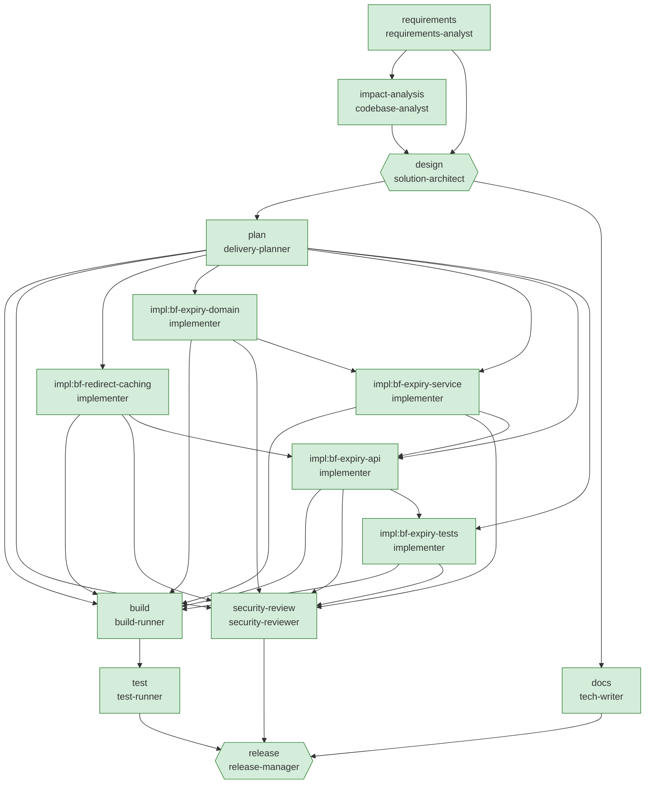

# Engineering summary — Brownfield: fix analytics undercount and add link expiration to the existing service

| Run | Scenario | Status | End-to-end | Graph version | Audit chain |
|---|---|---|---|---|---|
| `brownfield-20261003-201004` | brownfield | **Succeeded** | 8.4s | v2 | verified (106 events) |

> All nodes completed and all gates passed.

**What this scenario demonstrates:** The codebase analyst locates the root cause in source (301 permanent redirects are cached by browsers), maps impacted files, endpoints, data flows and tests (an existing test locks in the 301 behaviour and must change). The architect supersedes ADR-002. The reviewer rejects the first design with feedback, forcing a bounded revision. Tasks touching the same file are ordered and locked; the bug fix runs in parallel with the expiry domain/service work.

## 1. Requirement understanding

**Raw request** (every version, including upstream changes):

- v1 by `human:requester`: "Bug report from the marketing team: analytics undercount repeat clicks; when the same person opens a short link twice we only see one click. Feature request: links must support an optional expiry time, after which they stop redirecting."

**Normalised problem:** Change the existing URL shortener to: fix analytics undercount caused by cached redirects; link expiration, without breaking existing clients.

| Id | Requirement | Capability | Priority |
|---|---|---|---|
| FR-1 | Every redirect must reach the service so that each click is counted. | fix-redirect-caching | P0 |
| FR-2 | Allow an optional expiry timestamp at creation. | link-expiration | P1 |
| FR-3 | Expired links stop redirecting and report 410 Gone. | link-expiration | P1 |
| NFR-1 | Backward compatible: expiresAt is optional in requests and responses. | link-expiration | P1 |
| NFR-2 | Expiry evaluated with the injected TimeProvider (testable, UTC). | link-expiration | P1 |
| NFR-3 | Every change ships with automated tests that verify its acceptance criteria. | * | P0 |
| NFR-4 | No secrets or personal data in code or logs (policy-enforced). | * | P0 |

**Assumptions**

- In-memory storage is acceptable for this iteration; the repository port allows a durable store later.
- Authentication/authorisation is out of scope for this iteration (gateway responsibility).

## 2. Codebase impact (brownfield)

Blast radius **6** production files, risk **Medium**. Existing endpoints: `POST /api/links`, `GET /api/links/{code}`, `GET /api/links/{code}/stats`, `DELETE /api/links/{code}`, `GET /{code}`.

- **Root cause (fix-redirect-caching)** at `src/UrlShortener.Api/Api/LinkEndpoints.cs:59`: Redirects are issued as 301 Moved Permanently; browsers cache them, so repeat clicks never reach the service and are not counted.

| File | Why | Symbols |
|---|---|---|
| `src/UrlShortener.Api/Api/Contracts.cs` | touches link-expiration | CreateLinkRequest, LinkResponse, ShortLink |
| `src/UrlShortener.Api/Api/LinkEndpoints.cs` | touches fix-redirect-caching, link-expiration | CreateLinkCommand, CreateLinkRequest, LinkResponse, RedirectToTarget, Resolve |
| `src/UrlShortener.Api/Domain/ShortLink.cs` | touches link-expiration | ShortLink |
| `src/UrlShortener.Api/Services/LinkService.cs` | touches link-expiration | CreateLinkCommand, Resolve, ShortLink |
| `src/UrlShortener.Api/Storage/ILinkRepository.cs` | touches link-expiration | ShortLink |
| `src/UrlShortener.Api/Storage/InMemoryLinkRepository.cs` | touches link-expiration | ShortLink |
| `tests/UrlShortener.Tests/ApiIntegrationTests.cs` | touches fix-redirect-caching, link-expiration | CreateLinkRequest, LinkResponse, Redirect_sends_client_to_target |
| `tests/UrlShortener.Tests/LinkServiceTests.cs` | touches link-expiration | CreateLinkCommand |

Data flows:

- Browser → GET /{code} (now uncached on every click) → RecordClick
- POST /api/links {expiresAt} → LinkService.Create (validate future) → ShortLink.ExpiresAt
- GET /{code} → LinkService.Resolve → IsExpiredAt(now) → 410 | 302

## 3. Design

Incremental change to the existing layered service; impacted: Contracts.cs, LinkEndpoints.cs, ShortLink.cs, LinkService.cs, ILinkRepository.cs, InMemoryLinkRepository.cs, ApiIntegrationTests.cs, LinkServiceTests.cs.

| Method | Path | Responses | Change |
|---|---|---|---|
| POST | `/api/links` | 201, 400, 409 | adds optional expiresAt |
| GET | `/{code}` | 302, 404, 410 | 301 → 302 + no-store; adds 410 Gone |
| GET | `/api/links/{code}/stats` | 200, 404 |  |
| GET | `/api/links/{code}` | 200, 404 |  |
| DELETE | `/api/links/{code}` | 204, 404 |  |
| GET | `/health/live` | 200 |  |
| GET | `/health/ready` | 200 |  |

- **ADR-004 Temporary, non-cacheable redirects (supersedes ADR-002)** — Respond 302 Found with Cache-Control: no-store. *Why:* Analytics accuracy is a product requirement; 301s are cached indefinitely by browsers so repeat clicks never reach the service. *Trade-off:* Higher redirect traffic hits the service; acceptable at current scale, revisit with edge caching of lookups.
- **ADR-005 Lazy expiry evaluated on read** — Store expiresAt on the link; Resolve() returns Expired when now ≥ expiresAt; API maps to 410 Gone. *Why:* No background job or store-specific TTL needed; deterministic and testable with TimeProvider. *Trade-off:* Expired links occupy storage until a future cleanup job; alias stays reserved after expiry.
- _Addressed review feedback: Document that 302 + Cache-Control: no-store supersedes ADR-002, and confirm expired links answer 410 rather than 404._

## 4. Task decomposition

| Task | Title | Depends on | Files | Risk |
|---|---|---|---|---|
| `impl:bf-redirect-caching` | Make redirects temporary and non-cacheable (fix analytics undercount) |  | 2 | Medium |
| `impl:bf-expiry-domain` | Add optional expiry to the ShortLink domain model |  | 1 | Low |
| `impl:bf-expiry-service` | Validate expiry on create; report expired links on resolve | impl:bf-expiry-domain | 1 | Medium |
| `impl:bf-expiry-api` | Expose expiresAt in the API and answer 410 for expired links | impl:bf-expiry-service, impl:bf-redirect-caching | 2 | Medium |
| `impl:bf-expiry-tests` | Expiration unit and integration tests | impl:bf-expiry-api | 1 | Low |

Parallel groups: [impl:bf-redirect-caching, impl:bf-expiry-domain] → [impl:bf-expiry-service] → [impl:bf-expiry-api] → [impl:bf-expiry-tests]. Critical path: impl:bf-expiry-domain → impl:bf-expiry-service → impl:bf-expiry-api → impl:bf-expiry-tests.

## 5. Orchestration

| Node | Stage | Agent used | Status | Executions | Revisions |
|---|---|---|---|---|---|
| `requirements` | Requirements | requirements-analyst | Succeeded | 1 | 0 |
| `impact-analysis` | Design | codebase-analyst | Succeeded | 1 | 0 |
| `design` | Design | solution-architect | Succeeded | 1 | 1 |
| `plan` | Planning | delivery-planner | Succeeded | 1 | 0 |
| `docs` | Documentation | tech-writer | Succeeded | 1 | 0 |
| `build` | Testing | build-runner | Succeeded | 1 | 0 |
| `test` | Testing | test-runner | Succeeded | 1 | 0 |
| `security-review` | Security | security-reviewer | Succeeded | 1 | 0 |
| `release` | Release | release-manager | Succeeded | 1 | 0 |
| `impl:bf-redirect-caching` | Implementation | implementer | Succeeded | 1 | 0 |
| `impl:bf-expiry-domain` | Implementation | implementer | Succeeded | 1 | 0 |
| `impl:bf-expiry-service` | Implementation | implementer | Succeeded | 1 | 0 |
| `impl:bf-expiry-api` | Implementation | implementer | Succeeded | 1 | 0 |
| `impl:bf-expiry-tests` | Implementation | implementer | Succeeded | 1 | 0 |

**Notable control-flow events**

- `#2` **wave.started** — engine: Wave 1: requirements
- `#9` **wave.started** — engine: Wave 2: impact-analysis
- `#15` **wave.started** — engine: Wave 3: design
- `#22` **approval.decided** [design] — human:architect (scripted): REJECTED: Document that 302 + Cache-Control: no-store supersedes ADR-002, and confirm expired links answer 410 rather than 404.
- `#23` **node.revision** [design] — engine: Revision 1/2: Document that 302 + Cache-Control: no-store supersedes ADR-002, and confirm expired links answer 410 rather than 404.
- `#29` **approval.decided** [design] — human:architect (scripted): APPROVED: Revision accepted.
- `#31` **wave.started** — engine: Wave 4: plan, docs
- `#42` **graph.mutated** [plan] — agent:delivery-planner: Inserted 5 implementation tasks in 4 dependency levels (max parallelism 2).
- `#43` **wave.started** — engine: Wave 5: impl:bf-redirect-caching, impl:bf-expiry-domain
- `#49` **approval.decided** [impl:bf-redirect-caching] — human:unattended: APPROVED: Auto-approved in unattended mode (risk Medium ≤ High).
- `#56` **wave.started** — engine: Wave 6: impl:bf-expiry-service
- `#62` **approval.decided** [impl:bf-expiry-service] — human:unattended: APPROVED: Auto-approved in unattended mode (risk Medium ≤ High).
- `#64` **wave.started** — engine: Wave 7: impl:bf-expiry-api
- `#70` **approval.decided** [impl:bf-expiry-api] — human:unattended: APPROVED: Auto-approved in unattended mode (risk Medium ≤ High).
- `#72` **wave.started** — engine: Wave 8: impl:bf-expiry-tests
- `#78` **wave.started** — engine: Wave 9: build, security-review
- `#88` **wave.started** — engine: Wave 10: test
- `#97` **wave.started** — engine: Wave 11: release
- `#104` **approval.decided** [release] — human:release-manager (scripted): APPROVED: Go for 1.1.0.

## 6. Validation

- Tests: **43/43 passed**, 0 failed (4.4s).
- Security review: 0 findings, blocking: False. Dependencies: coverlet.collector 6.0.0 (UrlShortener.Tests.csproj), Microsoft.AspNetCore.Mvc.Testing 8.0.8 (UrlShortener.Tests.csproj), Microsoft.NET.Test.Sdk 17.8.0 (UrlShortener.Tests.csproj), xunit 2.5.3 (UrlShortener.Tests.csproj), xunit.runner.visualstudio 2.5.3 (UrlShortener.Tests.csproj).
- Gates evaluated: 9 (0 failed at some point).

| AC | Criterion | Verified by | ✔ |
|---|---|---|---|
| AC-1 | Redirects are temporary (302) and marked Cache-Control: no-store. | Redirect_is_temporary_and_not_cacheable, Redirect_sends_client_to_target | yes |
| AC-2 | Repeat clicks from the same client are each counted. | Repeat_clicks_are_each_counted | yes |
| AC-3 | A future expiresAt is accepted and returned; a past one is rejected with 400. | Create_accepts_future_expiry, Create_rejects_expiry_in_the_past | yes |
| AC-4 | An expired link returns 410 Gone and the click is not counted. | Expired_link_returns_410_and_is_not_counted | yes |
| AC-5 | Links without expiry keep working indefinitely (backward compatible). | Link_without_expiry_never_expires | yes |
| AC-6 | Metadata exposes expiresAt. | Metadata_includes_expiry | yes |

**Release 1.1.0 checklist** (ready: True)

- [x] Test suite green — 43/43 passed
- [x] All acceptance criteria verified by passing tests — 6/6 verified
- [x] No blocking security findings — 0 findings, 5 deps
- [x] Documentation updated — docs manifest present
- [x] Design approved by a human — approval recorded in decision log
- [x] Change control: no unresolved policy blocks — 0 blocked proposals were rejected before apply
- [x] Out-of-scope items logged as follow-ups — none

**Rollback plan**

- Redeploy the previous artifact (blue/green switch back); no data migration is involved (in-memory store).
- Source-level: revert the change sets listed in the audit log (engine keeps per-file compensation).
- expiresAt is optional and additive; older clients are unaffected, so a rollback is safe.

## 7. Governance and decision lineage

| Id | Node | Category | Decision | Actor | Rationale |
|---|---|---|---|---|---|
| D001 | requirements | scope | Existing capabilities referenced as context only | agent:requirements-analyst | Mentions of link-creation, redirect, click-analytics describe current behaviour, not new work. |
| D002 | requirements | scope | Scope: fix-redirect-caching, link-expiration | agent:requirements-analyst | Only the requested changes; existing behaviour must remain backward compatible. |
| D003 | impact-analysis | design | Root cause for fix-redirect-caching at src/UrlShortener.Api/Api/LinkEndpoints.cs:59 | agent:codebase-analyst | Redirects are issued as 301 Moved Permanently; browsers cache them, so repeat clicks never reach the service and are not counted. |
| D004 | design | design | ADR-004: Temporary, non-cacheable redirects (supersedes ADR-002) | agent:solution-architect | Analytics accuracy is a product requirement; 301s are cached indefinitely by browsers so repeat clicks never reach the service. |
| D005 | design | design | ADR-005: Lazy expiry evaluated on read | agent:solution-architect | No background job or store-specific TTL needed; deterministic and testable with TimeProvider. |
| D006 | design | approval | Rejected: Approve output of 'design' | human:architect (scripted) | Document that 302 + Cache-Control: no-store supersedes ADR-002, and confirm expired links answer 410 rather than 404. |
| D007 | design | design | ADR-004: Temporary, non-cacheable redirects (supersedes ADR-002) | agent:solution-architect | Analytics accuracy is a product requirement; 301s are cached indefinitely by browsers so repeat clicks never reach the service. |
| D008 | design | design | ADR-005: Lazy expiry evaluated on read | agent:solution-architect | No background job or store-specific TTL needed; deterministic and testable with TimeProvider. |
| D009 | design | design | Design revised after review | agent:solution-architect | Addressed review feedback: Document that 302 + Cache-Control: no-store supersedes ADR-002, and confirm expired links answer 410 rather than 404. |
| D010 | design | approval | Approved: Approve output of 'design' | human:architect (scripted) | Revision accepted. |
| D011 | plan | plan | Plan of 5 tasks | agent:delivery-planner | Recipes selected from capabilities, closed over dependencies, ordered by shared files; tests are mandatory tasks. |
| D012 | plan | plan | Expanded workflow graph to v2 with 5 nodes | agent:delivery-planner | Inserted 5 implementation tasks in 4 dependency levels (max parallelism 2). |
| D013 | impl:bf-redirect-caching | approval | Approved: Approve output of 'impl:bf-redirect-caching' | human:unattended | Auto-approved in unattended mode (risk Medium ≤ High). |
| D014 | impl:bf-expiry-service | approval | Approved: Approve output of 'impl:bf-expiry-service' | human:unattended | Auto-approved in unattended mode (risk Medium ≤ High). |
| D015 | impl:bf-expiry-api | approval | Approved: Approve output of 'impl:bf-expiry-api' | human:unattended | Auto-approved in unattended mode (risk Medium ≤ High). |
| D016 | release | approval | Approved: Approve output of 'release' | human:release-manager (scripted) | Go for 1.1.0. |

## 8. Reliability metrics

- Node attempt success rate: **100.0%** over 15 agent attempts
- MTTR: **0.0s** across 1 recoveries (design via revision)
- Counters: approvals.human=6, approvals.rejected=1, graph.mutations=1, node.executions=15, node.succeeded=15, revisions=1

| Node | Stage | Agent | Duration | Status |
|---|---|---|---|---|
| requirements | Requirements | requirements-analyst | 0.0s | Succeeded |
| impact-analysis | Design | codebase-analyst | 0.1s | Succeeded |
| design | Design | solution-architect | 0.0s | Succeeded |
| plan | Planning | delivery-planner | 0.0s | Succeeded |
| docs | Documentation | tech-writer | 0.0s | Succeeded |
| impl:bf-redirect-caching | Implementation | implementer | 0.0s | Succeeded |
| impl:bf-expiry-domain | Implementation | implementer | 0.0s | Succeeded |
| impl:bf-expiry-service | Implementation | implementer | 0.0s | Succeeded |
| impl:bf-expiry-api | Implementation | implementer | 0.0s | Succeeded |
| impl:bf-expiry-tests | Implementation | implementer | 0.0s | Succeeded |
| security-review | Security | security-reviewer | 0.0s | Succeeded |
| build | Testing | build-runner | 3.4s | Succeeded |
| test | Testing | test-runner | 4.5s | Succeeded |
| release | Release | release-manager | 0.0s | Succeeded |

## 9. Risks and trade-offs

| Id | Risk | L | I | Mitigation |
|---|---|---|---|---|
| R-LOAD | More requests reach the redirect path once caching stops | Medium | Low | Redirect path is O(1) in-memory; monitor p95 latency. |
| R-CLOCK | Clock skew between instances could flip expiry | Low | Low | UTC TimeProvider; expiry granularity is seconds. |
| R-MEM | In-memory store: data lost on restart, single instance only | High | High | Accepted for prototype; ILinkRepository port isolates a durable adapter (e.g. PostgreSQL unique index on code). |
| R-BLAST | Change touches 6 production files | Medium | Medium | Ordered tasks per file, full regression suite, human design approval. |

## 10. Limitations of this run

- Agents are deterministic and catalogue-driven: they recognise capabilities in the catalogue and apply reviewed recipes; they do not synthesise novel code. An LLM-backed agent can implement the same `IAgent` contract and is governed by the same gates, policies and approvals.
- Human approvals in non-interactive mode come from the scenario script or the unattended provider (recorded as such in the audit log). Use `--interactive` for real sign-off.
- The sandbox (`workspace/`) is not promoted into the repository automatically; promotion is a human action.
