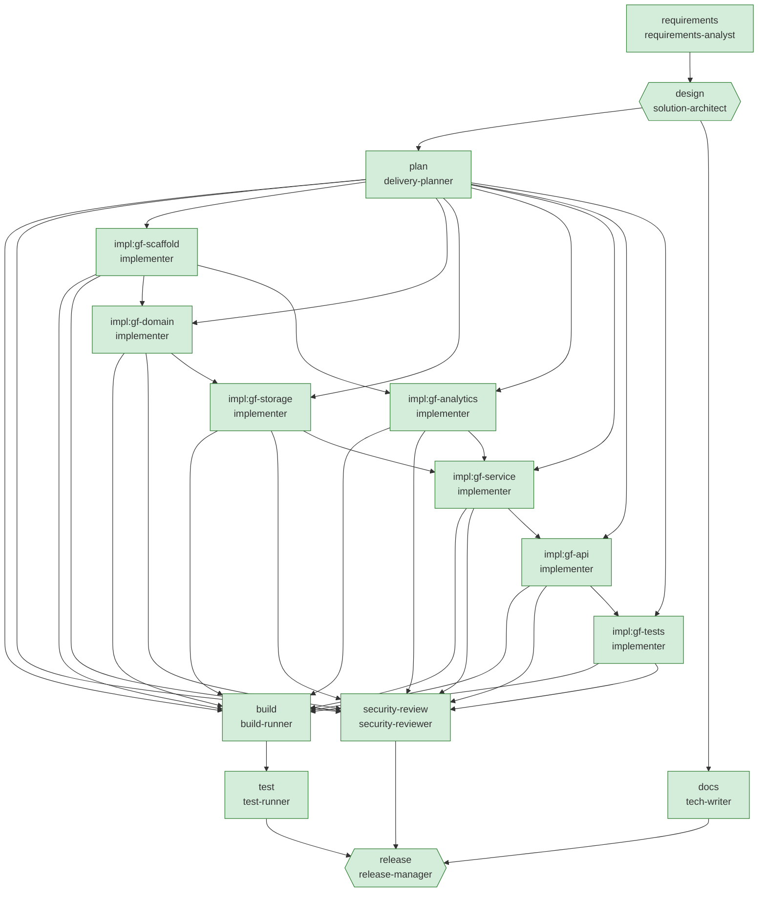

# Engineering summary — Greenfield: build the URL shortener v1 from an empty repository

| Run | Scenario | Status | End-to-end | Graph version | Audit chain |
|---|---|---|---|---|---|
| `greenfield-20261003-200952` | greenfield | **Succeeded** | 10.9s | v2 | verified (175 events) |

> All nodes completed and all gates passed.

**What this scenario demonstrates:** Well-defined requirement decomposed into 7 dependent tasks inserted into the graph at runtime (domain and analytics run in parallel). Injected faults exercise the recovery paths: a transient failure in the architect (bounded retry), a permanent failure in the docs writer (fallback agent), and a compile defect in the service layer (build gate fails → saga rollback of all implementation changes → remediation with feedback → green).

## 1. Requirement understanding

**Raw request** (every version, including upstream changes):

- v1 by `human:requester`: "Build a URL shortener service from scratch. Users shorten a long URL into a short code, optionally choosing a custom alias. Visiting the short link must redirect to the original URL. Provide click analytics per link: total clicks, unique visitors, top referrers and clicks per day. Users can look up and delete their links. The service must be reliable, with health probes, input validation and no personal data stored."

**Normalised problem:** Build a new URL shortener service that can: create short links; redirect short links; custom aliases; click analytics; link lookup and deletion; health probes.

| Id | Requirement | Capability | Priority |
|---|---|---|---|
| FR-1 | Accept an absolute http(s) URL and return a unique short code and short URL. | link-creation | P1 |
| FR-2 | Resolve a short code and redirect the client to the destination URL, recording a click. | redirect | P1 |
| FR-3 | Allow an optional custom alias instead of a generated code. | custom-alias | P1 |
| FR-4 | Expose per-link statistics: total clicks, unique visitors, last click, clicks per UTC day, top referrer hosts. | click-analytics | P1 |
| FR-5 | Get link metadata by code. | link-management | P1 |
| FR-6 | Delete a link and its analytics. | link-management | P1 |
| FR-7 | Expose liveness and readiness endpoints. | health-probes | P1 |
| NFR-1 | Codes must not be enumerable (CSPRNG). | link-creation | P1 |
| NFR-2 | Create is atomic under concurrency (no duplicate codes). | link-creation | P1 |
| NFR-3 | Redirect path does no I/O beyond one store lookup (latency-critical). | redirect | P1 |
| NFR-4 | Visitors pseudonymised with salted HMAC; referrer reduced to host. | click-analytics | P1 |
| NFR-5 | Per-link memory is bounded. | click-analytics | P1 |
| NFR-6 | Errors returned as RFC 7807 problem details; no stack traces. | health-probes | P1 |
| NFR-7 | Every change ships with automated tests that verify its acceptance criteria. | * | P0 |
| NFR-8 | No secrets or personal data in code or logs (policy-enforced). | * | P0 |

**Assumptions**

- In-memory storage is acceptable for this iteration; the repository port allows a durable store later.
- Authentication/authorisation is out of scope for this iteration (gateway responsibility).

## 3. Design

Layered minimal-API service: HTTP endpoints → LinkService → domain + ports (repository, analytics), in-memory adapters.

| Method | Path | Responses | Change |
|---|---|---|---|
| POST | `/api/links` | 201, 400, 409 |  |
| GET | `/{code}` | 301, 404 |  |
| GET | `/api/links/{code}/stats` | 200, 404 |  |
| GET | `/api/links/{code}` | 200, 404 |  |
| DELETE | `/api/links/{code}` | 204, 404 |  |
| GET | `/health/live` | 200 |  |
| GET | `/health/ready` | 200 |  |

- **ADR-001 Random base62 codes with bounded collision retry** — 7-char codes from a CSPRNG over base62; insert with atomic TryAdd; retry ≤ N times on collision. *Why:* Unpredictable codes prevent enumeration of other users' links; 62^7 ≈ 3.5e12 keeps collisions rare. *Trade-off:* Same URL shortened twice yields two codes (no dedupe).
- **ADR-002 Permanent (301) redirects** — Respond 301 Moved Permanently. *Why:* Cacheable by browsers and CDNs, minimising load on the redirect path. *Trade-off:* Repeat clicks served from browser cache are not observed by analytics.
- **ADR-003 Aggregate counters instead of raw click events** — Maintain per-link counters; hash visitor IPs with HMAC-SHA256 + secret salt; keep referrer host only. *Why:* Bounded memory and no click-level personal data trail (privacy by design). *Trade-off:* New metrics cannot be computed retroactively.

## 4. Task decomposition

| Task | Title | Depends on | Files | Risk |
|---|---|---|---|---|
| `impl:gf-scaffold` | Scaffold web project, configuration and options |  | 5 | Low |
| `impl:gf-domain` | Domain model, code generator and validation | impl:gf-scaffold | 3 | Low |
| `impl:gf-storage` | Repository port and in-memory adapter | impl:gf-domain | 2 | Low |
| `impl:gf-analytics` | Click analytics aggregation | impl:gf-scaffold | 2 | Low |
| `impl:gf-service` | Link service and visitor pseudonymisation | impl:gf-analytics, impl:gf-storage | 2 | Medium |
| `impl:gf-api` | HTTP endpoints, contracts and hosting | impl:gf-service | 4 | Medium |
| `impl:gf-tests` | Unit and integration test suite | impl:gf-api | 5 | Low |

Parallel groups: [impl:gf-scaffold] → [impl:gf-domain, impl:gf-analytics] → [impl:gf-storage] → [impl:gf-service] → [impl:gf-api] → [impl:gf-tests]. Critical path: impl:gf-scaffold → impl:gf-domain → impl:gf-storage → impl:gf-service → impl:gf-api → impl:gf-tests.

## 5. Orchestration

| Node | Stage | Agent used | Status | Executions | Revisions |
|---|---|---|---|---|---|
| `requirements` | Requirements | requirements-analyst | Succeeded | 1 | 0 |
| `design` | Design | solution-architect | Succeeded | 1 | 0 |
| `plan` | Planning | delivery-planner | Succeeded | 1 | 0 |
| `docs` | Documentation | docs-minimal | Succeeded | 1 | 0 |
| `build` | Testing | build-runner | Succeeded | 2 | 0 |
| `test` | Testing | test-runner | Succeeded | 1 | 0 |
| `security-review` | Security | security-reviewer | Succeeded | 2 | 0 |
| `release` | Release | release-manager | Succeeded | 1 | 0 |
| `impl:gf-scaffold` | Implementation | implementer | Succeeded | 2 | 0 |
| `impl:gf-domain` | Implementation | implementer | Succeeded | 2 | 0 |
| `impl:gf-storage` | Implementation | implementer | Succeeded | 2 | 0 |
| `impl:gf-analytics` | Implementation | implementer | Succeeded | 2 | 0 |
| `impl:gf-service` | Implementation | implementer | Succeeded | 2 | 0 |
| `impl:gf-api` | Implementation | implementer | Succeeded | 2 | 0 |
| `impl:gf-tests` | Implementation | implementer | Succeeded | 2 | 0 |

**Notable control-flow events**

- `#2` **wave.started** — engine: Wave 1: requirements
- `#9` **wave.started** — engine: Wave 2: design
- `#13` **agent.retry** [design] — engine: Transient failure; retrying in 250 ms.
- `#19` **approval.decided** [design] — human:architect (scripted): APPROVED: Layering and ADRs accepted. 301 for cacheability is acceptable for v1.
- `#21` **wave.started** — engine: Wave 3: plan, docs
- `#30` **node.fallback** [docs] — engine: Primary agent 'tech-writer' failed ([fault-injection] simulated permanent failure (e.g. upstream model unavailable).); switching to fallback 'docs-minimal'.
- `#35` **graph.mutated** [plan] — agent:delivery-planner: Inserted 7 implementation tasks in 6 dependency levels (max parallelism 2).
- `#36` **wave.started** — engine: Wave 4: impl:gf-scaffold
- `#42` **wave.started** — engine: Wave 5: impl:gf-domain, impl:gf-analytics
- `#53` **wave.started** — engine: Wave 6: impl:gf-storage
- `#59` **wave.started** — engine: Wave 7: impl:gf-service
- `#66` **approval.decided** [impl:gf-service] — human:unattended: APPROVED: Auto-approved in unattended mode (risk Medium ≤ High).
- `#68` **wave.started** — engine: Wave 8: impl:gf-api
- `#74` **approval.decided** [impl:gf-api] — human:unattended: APPROVED: Auto-approved in unattended mode (risk Medium ≤ High).
- `#76` **wave.started** — engine: Wave 9: impl:gf-tests
- `#82` **wave.started** — engine: Wave 10: build, security-review
- `#91` **node.failed** [build] — engine: Build failed with 1 compiler error(s): error CS0029: Cannot implicitly convert type 'string' to 'int'
- `#92` **rollback.completed** — engine: Remediation cycle 1 for 'build'
- `#93` **node.stale** [security-review] — engine: Input 'workspace.state' changed (v8→v9); node will re-execute.
- `#94` **remediation.started** [build] — engine: 'build' failed; rolling back and re-running [impl:gf-scaffold, impl:gf-domain, impl:gf-storage, impl:gf-analytics, impl:gf-service, impl:gf-api, impl:gf-tests] with failure feedback (cycle 1/2).
- `#95` **wave.started** — engine: Wave 11: impl:gf-scaffold
- `#102` **wave.started** — engine: Wave 12: impl:gf-domain, impl:gf-analytics
- `#115` **wave.started** — engine: Wave 13: impl:gf-storage
- `#122` **wave.started** — engine: Wave 14: impl:gf-service
- `#129` **approval.decided** [impl:gf-service] — human:unattended: APPROVED: Auto-approved in unattended mode (risk Medium ≤ High).
- `#131` **wave.started** — engine: Wave 15: impl:gf-api
- `#138` **approval.decided** [impl:gf-api] — human:unattended: APPROVED: Auto-approved in unattended mode (risk Medium ≤ High).
- `#140` **wave.started** — engine: Wave 16: impl:gf-tests
- `#147` **wave.started** — engine: Wave 17: build, security-review
- `#157` **wave.started** — engine: Wave 18: test
- `#166` **wave.started** — engine: Wave 19: release
- `#173` **approval.decided** [release] — human:release-manager (scripted): APPROVED: Go: checklist green, rollback plan reviewed.

## 6. Validation

- Tests: **36/36 passed**, 0 failed (5.2s).
- Security review: 0 findings, blocking: False. Dependencies: coverlet.collector 6.0.0 (UrlShortener.Tests.csproj), Microsoft.AspNetCore.Mvc.Testing 8.0.8 (UrlShortener.Tests.csproj), Microsoft.NET.Test.Sdk 17.8.0 (UrlShortener.Tests.csproj), xunit 2.5.3 (UrlShortener.Tests.csproj), xunit.runner.visualstudio 2.5.3 (UrlShortener.Tests.csproj).
- Gates evaluated: 7 (0 failed at some point).

| AC | Criterion | Verified by | ✔ |
|---|---|---|---|
| AC-1 | A valid http(s) URL returns 201 with code, short URL and Location header. | Create_returns_201_with_location_and_short_url, Create_generates_a_code_and_stamps_creation_time | yes |
| AC-2 | Relative, non-http(s), credential-bearing or oversized URLs are rejected with 400 problem+json. | Create_with_invalid_url_returns_validation_problem, Rejects_missing_relative_non_http_or_credentialed_urls, Rejects_urls_over_the_length_limit | yes |
| AC-3 | Code collisions are retried a bounded number of times, then fail safely. | Create_retries_on_code_collision, Create_fails_safely_when_collision_retries_are_exhausted | yes |
| AC-4 | Generated codes are unpredictable base62. | Generates_codes_of_requested_length_from_base62_alphabet, Generated_codes_are_not_trivially_repeated | yes |
| AC-5 | A known code redirects to its destination. | Redirect_sends_client_to_target | yes |
| AC-6 | Unknown codes return 404. | Unknown_code_returns_404 | yes |
| AC-7 | A taken alias is rejected with 409 and the original link is unchanged. | Duplicate_alias_returns_409, Create_rejects_duplicate_custom_alias | yes |
| AC-8 | Malformed or reserved aliases are rejected. | Rejects_malformed_or_reserved_aliases, Accepts_well_formed_aliases | yes |
| AC-9 | Stats aggregate totals, unique visitors, per-day counts and top referrers. | Aggregates_totals_unique_visitors_days_and_referrers, Stats_reflect_redirects_with_referrer_host_only | yes |
| AC-10 | No raw IPs or full referrer URLs are stored (privacy). | Stats_reflect_redirects_with_referrer_host_only | yes |
| AC-11 | Recording is safe under concurrent clicks and memory is bounded. | Concurrent_recording_loses_no_clicks, Caps_distinct_referrers_to_bound_memory | yes |
| AC-12 | Deleting a link makes it unreachable and removes its analytics. | Delete_makes_link_unreachable, Delete_removes_link_and_its_analytics | yes |
| AC-13 | Liveness and readiness endpoints return 200 when healthy. | Health_endpoints_report_healthy | yes |

**Release 1.0.0 checklist** (ready: True)

- [x] Test suite green — 36/36 passed
- [x] All acceptance criteria verified by passing tests — 13/13 verified
- [x] No blocking security findings — 0 findings, 5 deps
- [x] Documentation updated — docs manifest present
- [x] Design approved by a human — approval recorded in decision log
- [x] Change control: no unresolved policy blocks — 0 blocked proposals were rejected before apply
- [x] Out-of-scope items logged as follow-ups — none

**Rollback plan**

- Redeploy the previous artifact (blue/green switch back); no data migration is involved (in-memory store).
- Source-level: revert the change sets listed in the audit log (engine keeps per-file compensation).

## 7. Governance and decision lineage

| Id | Node | Category | Decision | Actor | Rationale |
|---|---|---|---|---|---|
| D001 | requirements | scope | Scope: link-creation, redirect, custom-alias, click-analytics, link-management, health-probes | agent:requirements-analyst | Capabilities explicitly requested for v1. |
| D002 | design | design | ADR-001: Random base62 codes with bounded collision retry | agent:solution-architect | Unpredictable codes prevent enumeration of other users' links; 62^7 ≈ 3.5e12 keeps collisions rare. |
| D003 | design | design | ADR-002: Permanent (301) redirects | agent:solution-architect | Cacheable by browsers and CDNs, minimising load on the redirect path. |
| D004 | design | design | ADR-003: Aggregate counters instead of raw click events | agent:solution-architect | Bounded memory and no click-level personal data trail (privacy by design). |
| D005 | design | approval | Approved: Approve output of 'design' | human:architect (scripted) | Layering and ADRs accepted. 301 for cacheability is acceptable for v1. |
| D006 | plan | plan | Plan of 7 tasks | agent:delivery-planner | Recipes selected from capabilities, closed over dependencies, ordered by shared files; tests are mandatory tasks. |
| D007 | docs | recovery | Fallback from 'tech-writer' to 'docs-minimal' | engine | [fault-injection] simulated permanent failure (e.g. upstream model unavailable). |
| D008 | docs | recovery | Documentation debt recorded | agent:docs-minimal | Primary documentation agent failed; minimal API reference keeps the release gate satisfiable, follow-up required. |
| D009 | plan | plan | Expanded workflow graph to v2 with 7 nodes | agent:delivery-planner | Inserted 7 implementation tasks in 6 dependency levels (max parallelism 2). |
| D010 | impl:gf-service | approval | Approved: Approve output of 'impl:gf-service' | human:unattended | Auto-approved in unattended mode (risk Medium ≤ High). |
| D011 | impl:gf-api | approval | Approved: Approve output of 'impl:gf-api' | human:unattended | Auto-approved in unattended mode (risk Medium ≤ High). |
| D012 | build | recovery | Remediation cycle 1: re-run 'implementation' nodes | engine | Bounded remediation policy (2 cycles) for failure: Build failed with 1 compiler error(s): error CS0029: Cannot implicitly convert type 'string' to 'int' |
| D013 | impl:gf-service | approval | Approved: Approve output of 'impl:gf-service' | human:unattended | Auto-approved in unattended mode (risk Medium ≤ High). |
| D014 | impl:gf-api | approval | Approved: Approve output of 'impl:gf-api' | human:unattended | Auto-approved in unattended mode (risk Medium ≤ High). |
| D015 | release | approval | Approved: Approve output of 'release' | human:release-manager (scripted) | Go: checklist green, rollback plan reviewed. |

## 8. Reliability metrics

- Node attempt success rate: **88.5%** over 26 agent attempts
- MTTR: **1.0s** across 3 recoveries (design via retry, docs via fallback, build via fallback)
- Counters: approvals.human=6, fallbacks=1, graph.mutations=1, node.executions=26, node.failed=3, node.succeeded=23, remediations=1, retries=1, rollbacks=1, stale.invalidations=1

| Node | Stage | Agent | Duration | Status |
|---|---|---|---|---|
| requirements | Requirements | requirements-analyst | 0.0s | Succeeded |
| design | Design | solution-architect | 0.3s | Succeeded |
| plan | Planning | delivery-planner | 0.0s | Succeeded |
| docs | Documentation | docs-minimal | 0.0s | Succeeded |
| impl:gf-scaffold | Implementation | implementer | 0.1s | Succeeded |
| impl:gf-domain | Implementation | implementer | 0.0s | Succeeded |
| impl:gf-analytics | Implementation | implementer | 0.0s | Succeeded |
| impl:gf-storage | Implementation | implementer | 0.0s | Succeeded |
| impl:gf-service | Implementation | implementer | 0.0s | Succeeded |
| impl:gf-api | Implementation | implementer | 0.0s | Succeeded |
| impl:gf-tests | Implementation | implementer | 0.0s | Succeeded |
| security-review | Security | security-reviewer | 0.0s | Succeeded |
| build | Testing | build-runner | 2.5s | Failed |
| impl:gf-scaffold | Implementation | implementer | 0.0s | Succeeded |
| impl:gf-domain | Implementation | implementer | 0.0s | Succeeded |
| impl:gf-analytics | Implementation | implementer | 0.0s | Succeeded |
| impl:gf-storage | Implementation | implementer | 0.0s | Succeeded |
| impl:gf-service | Implementation | implementer | 0.0s | Succeeded |
| impl:gf-api | Implementation | implementer | 0.0s | Succeeded |
| impl:gf-tests | Implementation | implementer | 0.0s | Succeeded |
| security-review | Security | security-reviewer | 0.0s | Succeeded |
| build | Testing | build-runner | 2.5s | Succeeded |
| test | Testing | test-runner | 5.3s | Succeeded |
| release | Release | release-manager | 0.0s | Succeeded |

## 9. Risks and trade-offs

| Id | Risk | L | I | Mitigation |
|---|---|---|---|---|
| R-COL | Code-space collisions under high volume | Low | Medium | Bounded retry + 503 with alerting; widen CodeLength via config. |
| R-PII | Analytics could capture personal data | Medium | High | HMAC visitor hash, referrer host only, compliance policy blocks PII in logs. |
| R-AUTHZ | No authentication: anyone can delete any link | High | High | Out of scope for prototype; gateway auth (API keys/OAuth) before production. |
| R-MEM | In-memory store: data lost on restart, single instance only | High | High | Accepted for prototype; ILinkRepository port isolates a durable adapter (e.g. PostgreSQL unique index on code). |

## 10. Limitations of this run

- Agents are deterministic and catalogue-driven: they recognise capabilities in the catalogue and apply reviewed recipes; they do not synthesise novel code. An LLM-backed agent can implement the same `IAgent` contract and is governed by the same gates, policies and approvals.
- Human approvals in non-interactive mode come from the scenario script or the unattended provider (recorded as such in the audit log). Use `--interactive` for real sign-off.
- The sandbox (`workspace/`) is not promoted into the repository automatically; promotion is a human action.
